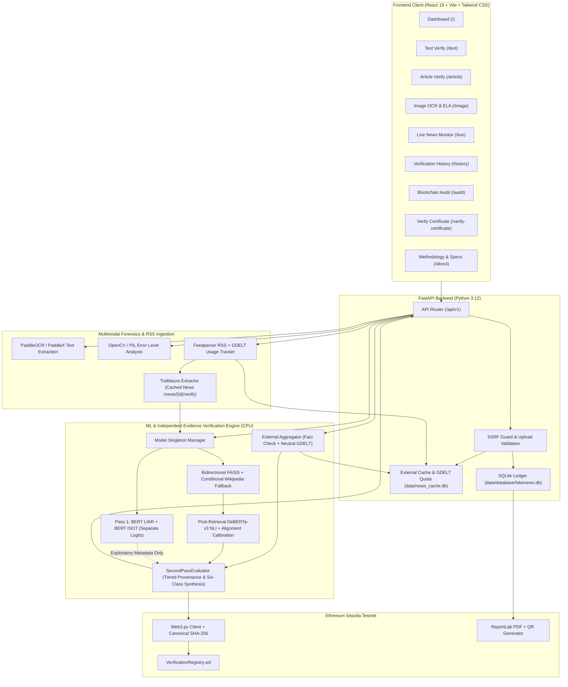

# SYSTEM ARCHITECTURE SPECIFICATION
**Project:** FakeNewsBlockchain – Real-Time Multimodal Fake News Detection & Fact Verification  
**Architecture Version:** 2.0.0 (Phase 3 IEVE Architecture)

---

## 1. Architectural Principles & Truth Delimitation

The core philosophy of **FakeNewsBlockchain** is that **machine-learning classification is not fact verification** and **absence of evidence is never evidence of falsehood**.

1. **Separation of Preliminary Linguistic Signals and Evidence Evaluation (IEVE):**
   - **Pass 1 Linguistic Signals (Non-Filtering):** `BERT LIAR` (`short_claim`) and `BERT ISOT` (`full_article`) emit raw logits and class probabilities separately as exploratory indicators. Neither model filters retrieval or restricts supporting vs. contradicting evidence collection.
   - **Prediction-Independent Bidirectional Collection:** For every claim, retrieval runs separate `support_oriented`, `contradiction_oriented`, and `neutral` formulations across local FAISS (`wiki_fever.index`), conditional read-only Wikipedia (`en.wikipedia.org`), bidirectional Google Fact Check ClaimReviews (when configured), and bounded neutral GDELT DOC 2.0 queries (skipped for static elementary science facts cleanly as `skipped_static_reference_fact`, and capped at at most 2 central/material claims per article).
   - **Pass 2 Evidence-Grounded NLI & Provenance Synthesis:** `DeBERTa-v3` evaluates `(claim, evidence)` pairs strictly post-retrieval (`SUPPORTS`, `REFUTES`, `NOT ENOUGH INFO`), followed by alignment calibration, source tiering (`Tier 1` primary institutional vs. `Tier 2` secondary encyclopedic FEVER/Wikipedia vs. `Tier 3` review/coverage metadata), conflict checks, temporal reasoning, and conservative six-class synthesis:
     - **GENUINE:** Supported by qualifying Tier 1 primary records or `>= 2` genuinely independent corroborated sources including Tier 2, with no unresolved conflicts or pure stale-2017 ambiguity.
     - **FAKE:** Refuted by Tier 1 official contradiction, `>= 2` independent corroborating contradictions including Tier 2, explicit Tier 2 numeric/slot/negation refutation, or `>= 2` independent ClaimReview refutations.
     - **OUTDATED:** Historically true facts framed in the present tense whose tenure, status, or name has explicitly closed (`shows_historical_end`), preserved ahead of the stale-2017 support guard once resolved without credible external conflicts.
     - **MISLEADING:** Identifiable subject claims involving verified entity/broadcaster swaps or absolute-framing distortions contradicted by aligned documentary evidence.
     - **PARTIALLY_TRUE:** Compound claims or multi-claim articles containing both substantiated and refuted sub-claims evaluated independently.
     - **UNVERIFIED:** Insufficient, irrelevant, uncorroborated single Tier 2, unresolved conflicting, Tier-1-dependent without official primary records, or stale-2017-only present-tense claims.
   - *(Legacy aliases `LIKELY_GENUINE` and `LIKELY_FAKE` remain accepted only when reading/filtering historical pre-audit SQLite and Sepolia records.)*

---

## 2. High-Level System Architecture



---

## 3. Component Breakdown

### A. Frontend Application (Presentation Layer)
- **Framework:** React 19 with Vite 8 and TypeScript.
- **Styling & Animation:** Tailwind CSS (`darkMode: 'class'`), `lucide-react` icons, and `motion` (`^14.9.1`).
- **Implemented Pages (`frontend/src/App.tsx`):**
  1. `Dashboard` (`/`): Quick claim launcher, local verification stats, and shortcuts to workflows.
  2. `TextVerify` (`/text`): Single & compound claim IEVE checker, 6-class preset pills, evidence cards, and collapsible `EvidenceAuditTrailCard`.
  3. `ArticleVerify` (`/article`): Full article verifier using `BERT ISOT` + claim decomposition + per-claim isolated evidence tabs and rollup.
  4. `ImageAnalysis` (`/image`): `JPG`/`PNG`/`WEBP` upload for PaddleOCR extraction, ELA heatmap preview, epistemological warnings (`UNVERIFIED`), and handoff to `/text`.
  5. `LiveNews` (`/live`): Cached RSS/GDELT feed browser, external API/GDELT quota card, feed refresh (`POST /api/v1/news/refresh`), and one-click cached article URL extraction + verification (`POST /api/v1/news/{id}/verify`).
  6. `History` (`/history`): Searchable, filterable SQLite verification ledger with PDF certificate download links.
  7. `AuditExplorer` (`/audit`): Sepolia ledger viewer, live on-chain SHA-256 comparison (`compareAuditRecord`), and Etherscan links.
  8. `VerifyCertificate` (`/verify-certificate`): Independent QR/ID/hash verification portal against `VerificationRegistry.sol`.
  9. `About` (`/about`): Scientific methodology, model limitations, and 6-class verdict guide.

---

### B. Backend Application (API & Service Layer)
- **Framework:** FastAPI on Python 3.12 with Uvicorn ASGI server (`starlette.concurrency.run_in_threadpool` for CPU-bound inference).
- **Data Validation:** Pydantic v2 schemas for all requests, responses, and IEVE audit trails.
- **Storage:**
  - `data/database/fakenews.db` (SQLite via `sqlite3` / repository layer) for persistent verification records (`185+` rows, including anchored Sepolia record `verif-9c524ca7b6f5`).
  - `data/news_cache.db` for cached RSS headlines, external evidence cache (`external_evidence_cache`), and atomic `gdelt_usage_state` quota accounting (`200`-request allowance tracking).
- **Security & Network Protections:**
  - Strict SSRF guard in `backend/app/services/news_service.py` (`is_safe_url`) and `ml/rag/wikipedia_fallback.py` (`en.wikipedia.org` HTTPS allowlist): loopback, private RFC 1918 ranges (`10.0.0.0/8`, `172.16.0.0/12`, `192.168.0.0/16`), link-local / cloud metadata (`169.254.169.254`), and non-HTTP schemes (`file://`) are rejected immediately.
  - Image uploads enforce strict MIME types (`image/jpeg`, `image/png`, `image/webp`) and a `10 MB` limit.

---

### C. ML, Retrieval & Second-Pass IEVE Engine
1. **CPU Resource Management:** `ModelManager` singleton lazy-loads models once under `torch.inference_mode()`, `torch.set_num_threads(4)`, and concurrency semaphores (`get_ml_inference_semaphore`), mapping `Requirements/sentences.jsonl` via byte-offset index (`126,000` vectors in `wiki_fever.index`).
2. **Dense Retrieval & Directional Expansion:** `all-MiniLM-L6-v2` (384d) encodes normalized queries across support, contradiction, and neutral formulations. Conditional Wikipedia fallback triggers only for sparse/post-2017/current-state coverage.
3. **Second-Pass Precedence (`ml/inference/second_pass_synthesizer.py`):**
   - `Case 0`: Institutional/primary-record claims require Tier 1 official records -> abstains `UNVERIFIED` (unless `>= 2` independent ClaimReviews refute as a hoax -> `FAKE`).
   - `Case C`: Credible unresolved conflicts (across tiers, publishers, or active vs. historical framing) -> abstains `UNVERIFIED`.
   - `Case A / Case B`: Resolved `OUTDATED` (historical closure) and `MISLEADING` (entity/slot/framing distortion) evaluated **before** the stale-2017 snapshot support guard.
   - `Case D`: Stale-2017 FEVER-only present-tense **`GENUINE`** assertions without live confirmation -> rejected to `UNVERIFIED`.
   - `Case E / Case F / Case G`: Strict tiered provenance sufficiency checks for `GENUINE` and `FAKE`.

---

### D. Image Analysis Engine (`ml/vision/`)
1. **OCR Pipeline:** `PaddleOCR` / `PaddleX` extracts text lines, bounding polygons, and confidence metrics.
2. **Error Level Analysis (ELA):** Re-compresses uploaded image at quality `90`, computes scaled pixel error intensity maps:
   $$\Delta(x, y) = |\mathbf{I}_{\text{orig}}(x, y) - \mathbf{I}_{\text{recomp}}(x, y)| \times \text{scale}$$
3. **Epistemological Guardrail:** Standalone image analysis always sets `verdict = "UNVERIFIED"` and `factual_verification_status = "UNVERIFIED"`.

---

### E. Blockchain Integrity & Certificates Layer
- **Network & Contract:** Ethereum Sepolia Testnet (`chain_id = 11155111`) hosting [`VerificationRegistry.sol`](blockchain/contracts/VerificationRegistry.sol):
  ```solidity
  struct VerificationRecord {
      string verificationId;
      bytes32 recordHash;
      address submitter;
      uint256 timestamp;
      bool isRegistered;
  }
  ```
- **Canonical Verification Hash:** `CanonicalVerificationRecord` (`schema_version = "1.0"`) serializes `{confidence_score, evidence_hashes, original_content_hash, primary_verdict, schema_version, timestamp, verification_id}` with sorted keys and compact separators `(",", ":")`, then computes SHA-256.
- **Certificates:** [`certificate_service.py`](backend/app/services/certificate_service.py) uses `reportlab` and `qrcode` to generate downloadable vector PDF certificates bound to on-chain confirmed records.

---

## 4. Repository Layout

```text
FakeNewsBlockChain/
├── pyproject.toml                       # Python 3.12 runtime & test dependencies
├── .env.example                         # Environment variable template (secrets omitted)
├── README.md                            # Startup, demo sequence & verification guide
├── ARCHITECTURE.md                      # Phase 3 IEVE architecture specification
├── API_SPECIFICATION.md                 # Implemented FastAPI v1 endpoint contract
├── scripts/check_assets.py              # Offline model & FAISS integrity checker
├── Requirements/                        # Local models & 126k FEVER FAISS index
├── data/                                # SQLite databases (fakenews.db, news_cache.db)
├── backend/
│   ├── app/
│   │   ├── main.py                      # FastAPI entry point & router registration
│   │   ├── config.py                    # Settings & GDELT timeout/retry validators
│   │   ├── api/routes/                  # verify, image, news, blockchain, history, certificates
│   │   ├── schemas/                     # Pydantic v2 contracts
│   │   └── services/                    # Core orchestration & external API clients
│   └── tests/                           # Pytest suites (isolated temp DBs & HTTP guards)
├── ml/
│   ├── inference/                       # Classifiers, DeBERTa NLI, IEVE & SecondPassEvaluator
│   ├── rag/                             # FAISSRetriever & SSRF-safe Wikipedia fallback
│   └── vision/                          # PaddleOCR & Error Level Analysis (ELA)
├── frontend/
│   ├── src/pages/                       # 9 React pages matching App.tsx routes
│   ├── src/components/                  # Reusable layout, verdict, blockchain & audit UI cards
│   └── src/api/verify.ts                # Fetch client for /api/v1/* endpoints
└── blockchain/                          # Solidity contract, Hardhat config & deploy artifacts
```
