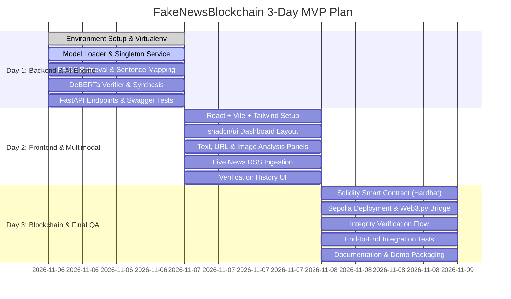

# PROJECT ROADMAP & IMPLEMENTATION MILESTONES
**Project:** FakeNewsBlockchain – Real-Time Multimodal Fake News Detection & Fact Verification  
**Target Horizon:** 3-Day Production-Grade MVP followed by Phase 2 Research Enhancements  

---

## 1. 3-Day MVP Milestone Breakdown

### Day 1 Deliverable: Verified Local AI Backend
1. **Virtual Environment & Dependencies:** Initialize isolated Python virtual environment with pinned versions of PyTorch (CPU), Transformers, Sentence-Transformers, FAISS-CPU, FastAPI, Uvicorn, and SQLite.
2. **Model Loading Architecture:** Create `ModelManager` singleton supporting lazy loading to optimize CPU and RAM usage.
3. **Retrieval Pipeline:** Connect `wiki_fever.index` with `all-MiniLM-L6-v2` and `sentences.jsonl` using efficient line indexing.
4. **Verification Pipeline:** Connect `fever_verifier_v1` (DeBERTa-v3), `bert_isot_temporal_v1`, and `bert_liar_v1` into the multi-signal verdict synthesis engine.
5. **API & Swagger Verification:** Implement `/api/v1/verify/text`, `/api/v1/verify/article`, and `/api/v1/health` with automated PyTest coverage.

### Day 2 Deliverable: Full-Stack Multimodal Application
1. **Frontend Architecture:** Initialize React + Vite + TypeScript application with Tailwind CSS, Lucide icons, and shadcn/ui components.
2. **Dashboard & Views:** Build Dashboard, Fact Checker, URL Analyzer, Image Analyzer, Live News, History, and About pages.
3. **Multimodal Ingestion:**
   - Trafilatura URL extraction with SSRF security filter.
   - PaddleOCR text extraction and OpenCV/PIL Error Level Analysis (ELA).
   - Free RSS headline ingestion (Reuters, BBC, AP) and GDELT connector.
4. **End-to-End Hookup:** Connect React frontend to FastAPI endpoints with loading states, error handling, and responsive cards.

### Day 3 Deliverable: Blockchain Anchoring & Complete Production MVP
1. **Smart Contract:** Develop `VerificationRegistry.sol` to record record IDs, content hashes, verification hashes, and timestamps.
2. **Sepolia & Web3.py:** Deploy contract to Sepolia testnet via Hardhat; connect FastAPI via Web3.py with automatic fallback for simulated mode.
3. **Tamper Detection:** Implement on-chain integrity verification comparison.
4. **Quality Assurance:** Execute full system tests, generate demo scripts, and compile setup documentation.

---

## 2. Post-MVP Roadmap (Phase 2 & Long-Term Research)

> [!IMPORTANT]
> The following 12 items are strictly preserved as deferred future enhancements. They will not be removed or compromised during MVP development.

1. **Additional Model Training & Fine-Tuning:**
   - Train domain-adapted transformer checkpoints on updated fact-checking datasets (e.g., MultiFC, Climate-FEVER, PolitiFact 2024–2026).
   - Address publisher and temporal distribution shifts identified in ISOT.

2. **Advanced Multimodal Foundation Models:**
   - Integrate vision-language foundation models (e.g., CLIP, BLIP-2, or open multimodal transformers) for cross-modal entailment (detecting caption-image contradiction).

3. **Stronger AI-Generated Image Detection:**
   - Integrate specialized deepfake and diffusion-artifact classifiers (e.g., frequency-domain analysis, Dire/CNN-based synthetic image detectors).

4. **Advanced Image Manipulation & Authenticity Analysis:**
   - Implement shadow/lighting inconsistency analysis, EXIF metadata tampering forensics, and copy-move forgery detection.

5. **Contextual & Visual Similarity Search:**
   - Build a reverse-image embedding index (using OpenCLIP + Milvus/FAISS) to match viral visual memes with debunks.

6. **Comprehensive Breaking News Monitoring:**
   - Scale ingestion from periodic RSS polling to streaming Kafka / Webhooks with real-time NLP clustering and topic discovery.

7. **Advanced Fact-Checking & Source Credibility Analysis:**
   - Build automated source reputation scoring (domain credibility index, historical bias ratings, Media Bias/Fact Check taxonomy).

8. **Retrieval & Reranking Optimization:**
   - Experiment with dense-sparse hybrid search (BM25 + ColBERT / BGE-reranker) and expand the Wikipedia knowledge base beyond the 126k FEVER subset.

9. **Model Calibration & Uncertainty Estimation:**
   - Implement temperature scaling, conformal prediction, and Monte Carlo dropout for rigorous confidence interval reporting.

10. **Ethereum Mainnet Deployment:**
    - Transition smart contract to production Ethereum Mainnet or cost-efficient Layer-2 rollups (e.g., Arbitrum, Optimism, Polygon) with Gas-optimized batching.

11. **Paid APIs or Cloud Infrastructure:**
    - Incorporate premium fact-checking feeds or scalable GPU cloud inference (AWS Bedrock, GCP Vertex AI, or RunPod) when budget and approvals permit.

12. **Production Deployment & Scaling:**
    - Containerization via Docker & Kubernetes, Redis caching for frequent claims, horizontal FastAPI worker scaling, and automated CI/CD pipelines.
